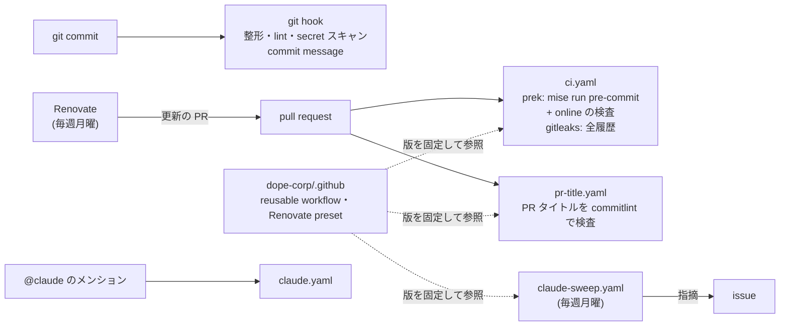
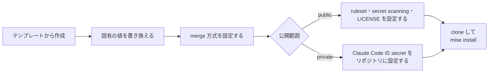

# template

[](https://github.com/dope-corp/template/actions/workflows/ci.yaml)

dope-corp の新規リポジトリ用のテンプレートです。commit 時の検査・CI・依存の自動更新・Claude Code の設定が揃った状態でリポジトリを始められます。

CI の一部・Claude の週次レビュー・Renovate の設定は、[dope-corp/.github](https://github.com/dope-corp/.github) の共通設定を版を固定して参照します。共通設定の新しい版は、Renovate の更新 PR で取り込まれます。issue・PR の雛形と `SECURITY.md` も、dope-corp/.github が organization の既定として配ります。

## 含まれるもの

| 用途            | ファイル                                                                           | 内容                                                                                                                  |
| --------------- | ---------------------------------------------------------------------------------- | --------------------------------------------------------------------------------------------------------------------- |
| ツールとタスク  | `mise.toml` / `mise.lock`                                                          | ツールの版の固定と `mise run` のタスク                                                                                |
| commit 時の検査 | `.pre-commit-config.yaml` / `commitlint.config.mjs` / `dprint.json` / `typos.toml` | 整形・lint・secret スキャン・commit message の検査                                                                    |
| CI              | `.github/workflows/ci.yaml` / `pr-title.yaml` / `.github/jactionlint.yaml`         | PR ごとに commit 時の検査 (commit message を除く)・全履歴の secret スキャン・PR タイトルの検査を実行する              |
| Claude Code     | `.github/workflows/claude.yaml` / `claude-sweep.yaml`                              | `@claude` のメンションへの応答と、週次の差分レビュー                                                                  |
| 依存の更新      | `renovate.json`                                                                    | dope-corp/.github の Renovate preset を参照する。Renovate が週次で更新の PR を作り、minor / patch は自動で merge する |
| secret          | `fnox.toml`                                                                        | secret を環境変数としてコマンドに渡す [fnox](https://fnox.jdx.dev/) の設定                                            |
| GitHub          | `.github/CODEOWNERS`                                                               | reviewer                                                                                                              |
| エディタと git  | `.editorconfig` / `.gitattributes` / `.gitignore`                                  | UTF-8・LF・2 スペースに揃える。`.gitignore` はホワイトリスト方式                                                      |



## リポジトリを作る

このリポジトリのページの **Use this template → Create a new repository** で、Owner に `dope-corp` を選んで作ります。引き継がれるのはファイルだけなので、リポジトリの設定は作るたびに行います。



1. 次のファイルをそのリポジトリの値に書き換えます。

   | ファイル                                                | 書き換える内容                                                                                                                                                                                                                                                                                                                                                     |
   | ------------------------------------------------------- | ------------------------------------------------------------------------------------------------------------------------------------------------------------------------------------------------------------------------------------------------------------------------------------------------------------------------------------------------------------------ |
   | `README.md`                                             | 本文と CI badge の URL (`dope-corp/template`)。末尾の「タスク」節にある 4 行の HTML コメント (`mise-tasks` と `dprint-ignore` の開始と終了) は、タスクの一覧を書き込んで整形から外す位置なので残す                                                                                                                                                                 |
   | `.github/CODEOWNERS`                                    | reviewer                                                                                                                                                                                                                                                                                                                                                           |
   | `.github/workflows/*.yaml` / `.github/jactionlint.yaml` | self-hosted runner を使うときだけ、`runs-on`、dope-corp/.github の workflow を呼ぶ job の `with` の `runs-on` と `mise-version`、`self-hosted-runner`。信頼できる runner に限り、job に理由を添えて `# zizmor: ignore[self-hosted-runner]` を付ける。使ってよい条件は [dope-corp/.github の README](https://github.com/dope-corp/.github#reusable-workflow) にある |

2. GitHub の設定を行います。手順は「[GitHub リポジトリ設定](#github-リポジトリ設定)」にあります。
3. clone して、下の「セットアップ」を行います。

テンプレート側で後から変わった共通ファイルは `mise run template-diff` で比べて取り込みます (「[template との同期](#template-との同期)」)。

## セットアップ

[mise](https://mise.jdx.dev/) を使います。

```sh
mise trust    # このディレクトリの mise.toml を信頼する (初回のみ)
mise install  # ツールを入れ、git hook を登録する
```

`mise install` は、`mise.lock` に固定した版のツールを入れ、`prek install` で `pre-commit` と `commit-msg` の git hook を登録します。
main を checkout したままの `git commit` は hook が止めるので、作業はブランチで行います。

## ツールの版

版はすべて固定し、[Renovate](#依存の更新-renovate) が更新の PR を作ります。

| 対象                            | 固定する場所                                                                                    |
| ------------------------------- | ----------------------------------------------------------------------------------------------- |
| CLI (prek・dprint・gitleaks 等) | `mise.toml` の `[tools]` に exact version、`mise.lock` にプラットフォームごとの URL と checksum |
| commitlint とその設定パッケージ | `.pre-commit-config.yaml` の `additional_dependencies`                                          |
| hook の取得元                   | `.pre-commit-config.yaml` の `rev`                                                              |
| dprint の plugin                | `dprint.json` の `url@sha256`                                                                   |
| workflow の `uses:`             | commit SHA (版はコメントで併記)                                                                 |

CLI の更新 PR は `mise.lock` も、dprint の plugin の更新 PR は checksum も一緒に更新します。`mise.toml` の `[tools]` を手で変えたら、`mise lock` で `mise.lock` を追従させて同じ commit に含めます。`mise.lock` が古いと、手元と CI の `mise install` が失敗します。
CI もローカルも同じ `mise.lock` からツールを解決するので、CI の検査をローカルで再現できます。

`.gitignore` はホワイトリスト方式 (`*` ですべて無視し、`!` の行で許可したものだけを追跡する) です。新しいファイルを追跡するときは、末尾の「追跡しない」節より上に `!` の行を足します。ディレクトリは `!/src/` と `!/src/**` の両方を足します (git は無視したディレクトリの中を見ないので、`!/src/` だけでは中のファイルが追跡されず、`git status` にも出ません)。許可したディレクトリの下でも `.env*`・`*.local.toml` (`mise.local.toml`・`fnox.local.toml`)・`*.pem`・`*.key` は追跡しません。`.gitignore` は追跡済みのファイルには効かないので、既に commit したものは `git rm --cached <path>` で外します。

## commit 時の検査 (git hook)

hook は `.pre-commit-config.yaml` で定義します。git hook の種類 (`default_install_hook_types`) を変えたら `mise exec -- prek install` で登録し直します。

| hook                                                               | 対象                                | 内容                                                                                                                                                                             | 設定・除外の書き方                                                                                                                                       |
| ------------------------------------------------------------------ | ----------------------------------- | -------------------------------------------------------------------------------------------------------------------------------------------------------------------------------- | -------------------------------------------------------------------------------------------------------------------------------------------------------- |
| [pre-commit-hooks](https://github.com/pre-commit/pre-commit-hooks) | 全ファイル                          | 行末の空白・末尾の改行・改行コードを直し、YAML / JSON / TOML の構文、大きなファイル、conflict の印、macOS / Windows で checkout できない名前、symlink、shebang を検査する        | -                                                                                                                                                        |
| no-commit-to-branch                                                | -                                   | main を checkout しているときの commit を止める (*1)                                                                                                                             | -                                                                                                                                                        |
| mise-task-docs                                                     | `mise.toml`・`README.md`            | README のタスク一覧を生成し直す (`mise run docs`)                                                                                                                                | -                                                                                                                                                        |
| [dprint](https://dprint.dev/)                                      | json / yaml / markdown / toml       | 整形する                                                                                                                                                                         | `dprint.json`                                                                                                                                            |
| [jactionlint](https://jactionlint.jdx.dev/)                        | `.github/`                          | workflow の静的検査。warning も失敗にする (`timeout-minutes` は 30 分まで) と、`run:` の [shellcheck](https://github.com/koalaman/shellcheck) (optional check もすべて有効) (*2) | `.github/jactionlint.yaml`。除外は該当行の上に `# jactionlint ignore=<rule>`                                                                             |
| [zizmor](https://docs.zizmor.sh/)                                  | workflow・`.pre-commit-config.yaml` | セキュリティ監査。`--persona auditor` で全 finding を、`--strict-collection` で解析できない入力を失敗にする (*2)                                                                 | 該当行の `# zizmor: ignore[<audit 名>]`。jactionlint と同じ finding もこちらだけで除外する                                                               |
| [typos](https://github.com/crate-ci/typos)                         | 全ファイル                          | 英単語の typo。綴りは米国英語に揃える                                                                                                                                            | `typos.toml` の `extend-identifiers` (識別子) / `extend-words` (単語)                                                                                    |
| [gitleaks](https://github.com/gitleaks/gitleaks)                   | staged の差分                       | secret を検出する                                                                                                                                                                | 該当行の `gitleaks:allow` コメント。commit 済みの誤検知は `.gitleaksignore` に finding の Fingerprint を書き、`.gitignore` に `!/.gitleaksignore` を足す |
| [commitlint](https://commitlint.js.org/) (`commit-msg`)            | commit message                      | [Conventional Commits](https://www.conventionalcommits.org/) か検査する。node は prek が用意するので、リポジトリに node は要らない                                               | `commitlint.config.mjs`                                                                                                                                  |

除外は、誤検知と直せない箇所だけに理由のコメントを添えて書きます。

- (*1) Free plan の private リポジトリは ruleset で main への push を止められないので、手元で止めます。`mise run pre-commit` は検証用なので、この hook を除いて全ファイルに実行します。
- (*2) hook は commit を GitHub API に依存させないよう offline で動き、impostor commit・既知の脆弱性のある action 等の online の検査は CI だけで行います。手元で CI と同じ範囲を検査するには、`gh` で認証した状態で次を実行します。

  ```sh
  ZIZMOR_GITHUB_TOKEN="$(gh auth token)" mise exec -- zizmor --persona auditor --strict-collection .
  GITHUB_TOKEN="$(gh auth token)" mise exec -- jactionlint --strict-exit --online=strict
  ```

jactionlint は `.github/jactionlint.yaml` の列挙と食い違う workflow を失敗にします。次を変えたら列挙も揃えます。

| 変えたもの                                             | 揃える項目                                                                                                                                    |
| ------------------------------------------------------ | --------------------------------------------------------------------------------------------------------------------------------------------- |
| 外部の action / reusable workflow を足す               | `forbidden-uses` の `allow` (org の Actions 許可設定の範囲で。reusable workflow は `<owner>/<repo>/.github/workflows/*` のようにパスまで書く) |
| repository / organization の `vars` / `secrets` を足す | `config-variables` / `config-secrets`                                                                                                         |
| ruleset の required checks                             | `required-checks` (別リポジトリの reusable workflow が報告する check は、jactionlint が中を確かめられないので書かない)                        |

## CI

`.github/workflows/ci.yaml` と `pr-title.yaml` は、pull request で次の job を並列に実行します。main は PR 経由で変更するので、main への push では実行しません。job の `name` が required status check の名前になり、dope-corp/.github の reusable workflow を呼ぶ job は `<呼び出し側の job の name> / <本体の job の name>` になります。

| job                   | 内容                                                                                                                                                                                                                                                                                |
| --------------------- | ----------------------------------------------------------------------------------------------------------------------------------------------------------------------------------------------------------------------------------------------------------------------------------- |
| `prek`                | `mise run pre-commit` で全ファイルに commit 時の hook (commit message と `no-commit-to-branch` を除く) を実行し、zizmor と jactionlint を online の検査込みで実行する                                                                                                               |
| `gitleaks / gitleaks` | コミット履歴全体の secret を検出する (`reusable-gitleaks.yaml`)                                                                                                                                                                                                                     |
| `pr-title / pr-title` | PR タイトルと、squash merge で付く ` (#<番号>)` を足したタイトルを、commit-msg の commitlint hook で検査する (`reusable-pr-title.yaml`)。squash merge の commit title は PR タイトルになるので、タイトルを変えたときも検査し直す。直すときは merge の画面ではなく PR タイトルを直す |

手元で `gitleaks / gitleaks` job と同じ検査をするには `mise exec -- gitleaks git --redact -v .` を実行します。

build / test のあるリポジトリでは、それらを実行する `verify` job を足し、ruleset の required checks と `.github/jactionlint.yaml` の `required-checks` にも足します。参照実装は [dope-corp/web-app の ci.yaml](https://github.com/dope-corp/web-app/blob/main/.github/workflows/ci.yaml) です。

## 依存の更新 (Renovate)

`renovate.json` が参照する [dope-corp/.github の preset](https://github.com/dope-corp/.github/blob/main/renovate-preset.json) の設定で [Renovate](https://docs.renovatebot.com/) が、毎週月曜 9 時前 (Asia/Tokyo) の時間帯に、更新があれば PR を作ります。版の更新は、公開から 7 日たってから PR になります (pin、`lockFileMaintenance`、脆弱性の alert による更新を除く)。PR のタイトルは Conventional Commits にします。

| 更新                                           | PR                                                   | merge                                                                        |
| ---------------------------------------------- | ---------------------------------------------------- | ---------------------------------------------------------------------------- |
| minor / patch                                  | major 以外を `all non-major dependencies` にまとめる | PR の更新が minor / patch だけなら、CI が通れば Renovate が自動で merge する |
| pin / digest (同じタグのまま SHA だけ変わる等) | 同上                                                 | 人手 (この更新が入った PR は自動で merge しない)                             |
| `mise.lock` の再解決 (`lockFileMaintenance`)   | 単独 (月曜 4 時前)                                   | CI が通れば自動で merge する                                                 |
| major                                          | 原則として依存ごと                                   | 人手でレビューする                                                           |

リポジトリ固有の設定 (特定の依存の除外や group 等) は、`renovate.json` の `extends` の後に足します。dope-corp/.github の新しい版は、Renovate が `extends` の tag と workflow の参照を更新する PR を作ります (公開から 7 日を待たない)。

merge は Renovate 自身が全 status check の成功を確かめてから行います (`platformAutomerge: false`)。GitHub の auto-merge に任せると、required status check の無い private リポジトリでは CI を待たずに merge されるためです。そのぶん merge は Renovate の次の実行まで遅れます。public リポジトリで GitHub の auto-merge に切り替えるときは、ruleset で required status check を設定し、リポジトリの Allow auto-merge を有効にしてから `platformAutomerge` の行を消します。

## Claude Code

| workflow            | 起動                                                                                                                                | 動作                                                                                                                                                                                                                                                                                                          |
| ------------------- | ----------------------------------------------------------------------------------------------------------------------------------- | ------------------------------------------------------------------------------------------------------------------------------------------------------------------------------------------------------------------------------------------------------------------------------------------------------------- |
| `claude.yaml`       | OWNER / MEMBER が `@claude` を含む新規 issue (タイトルか本文)・コメント・PR レビューを書いたとき (書き込み権限は action が確かめる) | [claude-code-action](https://github.com/anthropics/claude-code-action) が依頼に応じて回答・commit する                                                                                                                                                                                                        |
| `claude-sweep.yaml` | 毎週月曜 9 時 (Asia/Tokyo)、`workflow_dispatch` (default branch のときだけレビューする)                                             | dope-corp/.github の `reusable-claude-sweep.yaml` を呼ぶ。前回成功した run の commit から HEAD までの差分を correctness / security / simplification の観点でレビューし、新しい指摘を `claude-sweep` label の issue にする。修正の PR は作らない。Claude が使えるのは差分と issue の読み書きに要るコマンドだけ |

`claude.yaml` は PR の head を checkout して動き、sandbox ではありません。外部の人の PR では、コードを確かめてから呼びます。

claude-sweep の動きです。

- 成功した run が無い初回はレビューせずに成功で終え、次回の起点にします。差分が無ければ Claude を起動しません。
- レビューが失敗すると起点が進まず、次回に同じ範囲をレビューし直します。

どちらも secret `CLAUDE_CODE_OAUTH_TOKEN` を使います。未設定だと `CLAUDE_CODE_OAUTH_TOKEN ... is required` で失敗します。

| 公開範囲 | secret の設定                                                                                                             |
| -------- | ------------------------------------------------------------------------------------------------------------------------- |
| public   | 不要 (organization secret を使う)                                                                                         |
| private  | Free plan では organization secret を参照できないので、`claude setup-token` で発行した token をリポジトリの secret にする |

```sh
claude setup-token
gh secret set CLAUDE_CODE_OAUTH_TOKEN --repo "dope-corp/<repo>"
```

`claude setup-token` の token は発行から 1 年で失効するので、失効する前に発行し直して secret を更新します。organization secret も同じです。

## GitHub リポジトリ設定

dope-corp は GitHub の Free plan なので、private リポジトリでは使えない機能があります。

| 設定                                                                                       | public                   | private                                                            |
| ------------------------------------------------------------------------------------------ | ------------------------ | ------------------------------------------------------------------ |
| merge 方式 (squash のみ・commit title は PR タイトル・merge 後にブランチを削除・wiki 無効) | リポジトリごとに設定する | リポジトリごとに設定する                                           |
| ruleset (main: PR 必須・CI 必須・squash のみ・force push と削除の禁止・linear history)     | リポジトリごとに設定する | 使えない。PR 経由で変更し、CI を確かめて merge する運用で守る      |
| secret scanning・push protection                                                           | リポジトリごとに設定する | 使えない。hook と CI の gitleaks で検出する                        |
| private vulnerability reporting と LICENSE                                                 | リポジトリごとに設定する | 不要 (外部の人がコードを見ない)                                    |
| organization secret (`CLAUDE_CODE_OAUTH_TOKEN`)                                            | 設定済み                 | 使えない。リポジトリの secret にする ([Claude Code](#claude-code)) |
| CODEOWNERS による reviewer の自動割当                                                      | 働く                     | 働かない                                                           |

private リポジトリで main への直接の push も検査したいときは、`ci.yaml` の `on:` に `push: { branches: [main] }` を足します (push の後に検出するだけで、止めはしません)。

organization で設定済みのもの (リポジトリごとの作業は不要) です。

| 設定           | 内容                                                                                                                                                                                                    |
| -------------- | ------------------------------------------------------------------------------------------------------------------------------------------------------------------------------------------------------- |
| Actions の許可 | GitHub 公式・verified creator と `jdx/mise-action@*`・`anthropics/claude-code-action@*` だけ。外部の action の SHA pin が必須                                                                           |
| Actions の PR  | `GITHUB_TOKEN` による PR の作成・承認を禁止 (workflow で PR を作る設計にしない)                                                                                                                         |
| GitHub App     | Renovate と Claude を全リポジトリにインストール済み                                                                                                                                                     |
| issue types    | Bug / Feature / Task (dope-corp/.github の issue form の `type:` で付ける)                                                                                                                              |
| 既定の雛形     | dope-corp/.github の issue・PR の雛形と `SECURITY.md` が、自前のファイルを持たないリポジトリに表示される。リポジトリ固有の issue の雛形を置くと、organization の既定の issue の雛形は一切使われなくなる |

### merge 方式 (共通)

```sh
REPO="dope-corp/<repo>"

gh api -X PATCH "repos/$REPO" --input - <<'JSON'
{
  "allow_merge_commit": false,
  "allow_rebase_merge": false,
  "allow_squash_merge": true,
  "squash_merge_commit_title": "PR_TITLE",
  "squash_merge_commit_message": "COMMIT_MESSAGES",
  "delete_branch_on_merge": true,
  "has_wiki": false
}
JSON
```

### ruleset・secret scanning・LICENSE (public のみ)

required checks は「[CI](#ci)」の job の `name` に合わせます。`verify` job を足したら `{"context": "verify", "integration_id": 15368}` も足します。

```sh
REPO="dope-corp/<repo>"

gh api -X POST "repos/$REPO/rulesets" --input - <<'JSON'
{
  "name": "Protect main",
  "target": "branch",
  "enforcement": "active",
  "bypass_actors": [],
  "conditions": {"ref_name": {"include": ["refs/heads/main"], "exclude": []}},
  "rules": [
    {"type": "deletion"},
    {"type": "non_fast_forward"},
    {"type": "required_linear_history"},
    {"type": "pull_request", "parameters": {
      "required_approving_review_count": 0,
      "dismiss_stale_reviews_on_push": false,
      "require_code_owner_review": false,
      "require_last_push_approval": false,
      "required_review_thread_resolution": false,
      "allowed_merge_methods": ["squash"]
    }},
    {"type": "required_status_checks", "parameters": {
      "do_not_enforce_on_create": false,
      "strict_required_status_checks_policy": false,
      "required_status_checks": [
        {"context": "prek", "integration_id": 15368},
        {"context": "gitleaks / gitleaks", "integration_id": 15368},
        {"context": "pr-title / pr-title", "integration_id": 15368}
      ]
    }}
  ]
}
JSON

gh api -X PATCH "repos/$REPO" --input - <<'JSON'
{
  "security_and_analysis": {
    "secret_scanning": {"status": "enabled"},
    "secret_scanning_push_protection": {"status": "enabled"}
  }
}
JSON

# 脆弱性を issue ではなく非公開で報告してもらう
gh api -X PUT "repos/$REPO/private-vulnerability-reporting"
```

public リポジトリには LICENSE を置き、`.gitignore` に `!/LICENSE` を足します。LICENSE が無いと利用の条件が示されず、第三者はコードを利用できません。

## template との同期

テンプレートのファイルは作成時に写されるだけで、後からテンプレートに入った変更は届きません (dope-corp/.github が配る reusable workflow の本体・Renovate preset・雛形は、Renovate の更新 PR と organization の既定で届きます)。`mise run template-diff` で、[dope-corp/template](https://github.com/dope-corp/template) の main にあるファイルを手元と比べた差分を表示します。テンプレートに後から足されたファイルは `missing locally` と表示します。差分にはリポジトリ固有の変更も混ざるので、取り込むものは手で選びます。リポジトリごとに書き換える `README.md`・`.github/CODEOWNERS`・`mise.lock` は比べません。

## 環境変数

ディレクトリ単位の環境変数は `mise.toml` の `[env]` に書き、`mise run` / `mise exec` で渡します。シェルにも反映するには [`mise activate`](https://mise.jdx.dev/getting-started.html#activate-mise) を設定します。手元だけの値は git 管理外の `mise.local.toml` に書きます。secret は fnox で渡します (`mise exec -- fnox exec -- <command>`)。`fnox.toml` は解決した secret をメモリに保持する daemon を有効にしている (無操作 12 時間で終了) ので、provider 側で secret を更新した直後は `mise exec -- fnox daemon clear` で破棄します。

## Node.js を使う場合

| 項目                 | 内容                                                                                                                                                                                                                                 |
| -------------------- | ------------------------------------------------------------------------------------------------------------------------------------------------------------------------------------------------------------------------------------ |
| 版の指定             | `.node-version` に major だけ (例: `26`) を書き、`.nvmrc` は作らない。Cloudflare のビルド等のツールもこのファイルを読む                                                                                                              |
| mise                 | `mise.toml` の `[settings]` に `idiomatic_version_file_enable_tools = ["node"]` を足し、`.node-version` を読ませる。`mise lock` で `mise.lock` に node を足し、これらと同じ commit に含める (無いと CI の `mise install` が失敗する) |
| `.gitignore`         | `!/.node-version` を足す                                                                                                                                                                                                             |
| minor / patch の更新 | Renovate の `lockFileMaintenance` が `mise.lock` を再解決して、同じ major の最新に追従する。この更新には 7 日の猶予がかからない                                                                                                      |
| major の更新         | Renovate の nodenv manager が PR を作る。この PR は `mise.lock` を更新しないので、そのブランチで `mise lock` を実行して commit する                                                                                                  |
| hook と `verify` job | eslint・typecheck 等の hook と `verify` job は [dope-corp/web-app](https://github.com/dope-corp/web-app) を参照実装にする                                                                                                            |

## タスク

`mise run <task>` で実行します。一覧は `mise.toml` の `[tasks]` から hook が生成します。

<!-- dprint-ignore-start -->
<!-- mise-tasks -->
## `docs`

- **Usage:** `docs`

README.md のタスク一覧を mise.toml から生成し直す

## `pre-commit`

- **Usage:** `pre-commit`

全ファイルに pre-commit の hook を実行する (CI の prek job のうち online の検査を除く部分)

## `template-diff`

- **Usage:** `template-diff`

共通ファイルを dope-corp/template の main と比べて差分を表示する
<!-- /mise-tasks -->
<!-- dprint-ignore-end -->
